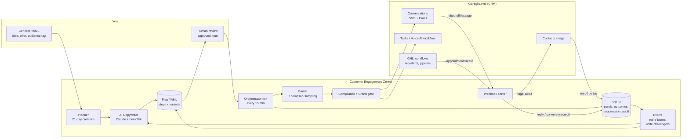

# Architecture

## Lifecycle of one campaign

1. **Concept** (`campaigns/*.yaml`): the only thing you write. It covers the objective, the
   angle, the offer, the audience tag and the channels.
2. **Plan** (`cli plan`): the planner lays out the 21-day cadence. Claude writes 3 variants per
   step, each testing a different hypothesis. Drafts that fail the brand linter are thrown
   away. The output is a YAML file you can read and edit.
3. **Approve**: you review every word and set `approved: true`. Nothing sends until you do.
4. **Enroll** (`cli enroll`): pulls contacts with the audience tag from GHL. It skips DND and
   suppressed contacts and deterministically holds back 10% as a **control group**.
5. **Run** (`cli run`, on cron every 15 min): for each active lead it sends the next due step.
   It enforces spacing (20h minimum), quiet hours, opt-outs and the brand lint. The bandit
   picks the variant.
6. **Listen** (`cli serve`): GHL webhooks arrive for replies, bookings and opt-outs.
   - A **reply** credits the variant, pauses automation and tags `ce-replied`. A GHL workflow
     then alerts the rep and creates an opportunity.
   - An **opt-out** in any wording puts the lead on global suppression, sets GHL DND and tags
     `ce-opted-out`.
   - A **booking or won deal** credits the variant, marks the lead converted and tags `ce-converted`.
7. **Evolve** (`cli evolve`, weekly): it retires variants with less than a 5% chance of being
   best (after 50+ sends each). Claude then writes a challenger modelled on the winner, which
   waits for your review.
8. **Report** (`cli report`): shows the funnel, **lift vs. holdout**, and per-step variant
   performance with P(best).

## Design decisions

| Decision | Why |
|---|---|
| GHL stays the system of record | Your team already lives in GHL. The engine only stores what GHL can't (variant attribution, bandit stats). |
| All CRM calls live in `ghl.py` | Swapping or adding a CRM later means one new file. |
| Human approval gate on the plan | AI drafts, humans publish. This protects the brand while trust is built. |
| Bandit, not fixed A/B | Old-lead lists are finite, so a bandit wastes fewer leads on losing copy. |
| 72h attribution window, pending sends not counted as failures | Stops new variants from being unfairly penalised before leads have had time to reply. |
| Holdout group | Reply rates alone can't prove ROI. Lift against a control group can. |
| Stricter-than-law defaults (8pm cutoff, broad opt-out matching) | One mistake with a TCPA claim costs more than the few replies lost. |
| Dry-run on by default | You go live on purpose, never by accident. |

## Deploying

- Any small VM or container (Render, Railway, Fly.io, a $6 droplet).
- `python -m engagement.cli serve` behind HTTPS for webhooks.
- Cron: `*/15 * * * * python -m engagement.cli run campaigns/<slug>.plan.yaml`.
- Weekly: `python -m engagement.cli evolve campaigns/<slug>.plan.yaml`.
- In GHL, create workflows that fire on tag `ce-replied` (notify the rep, create or move the
  opportunity) and send `AppointmentCreate` to the webhook URL.
